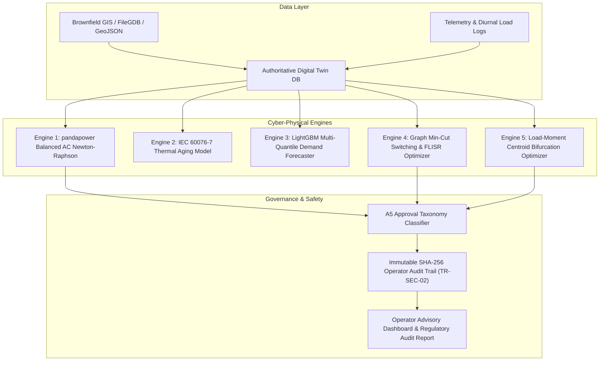
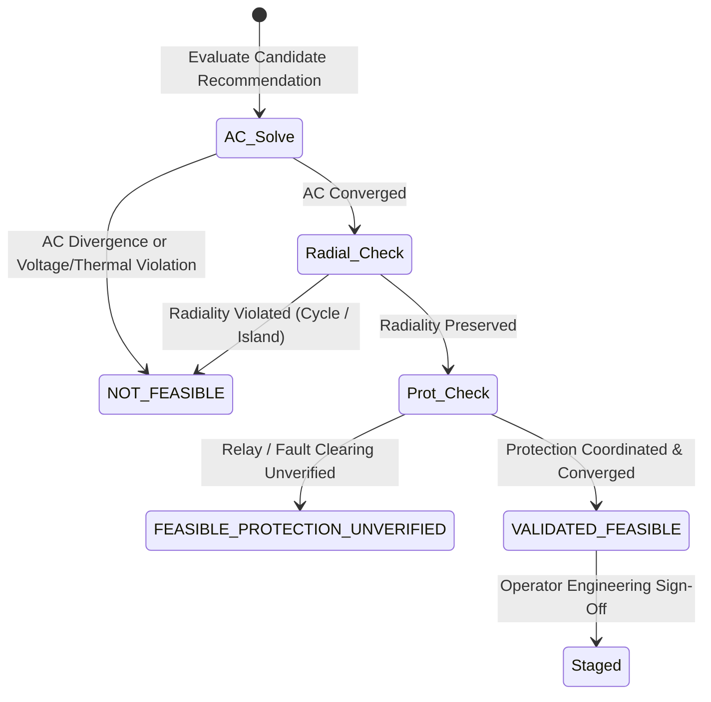

# Model Card: GridSense-AI Cyber-Physical Intelligence Suite

## 1. Model Details

- **Model Name:** GridSense-AI Cyber-Physical Intelligence Suite
- **Version:** v1.0.0
- **Organization:** GridSense-AI Engineering Team
- **Model Type:** Hybrid Cyber-Physical & Machine Learning Ensemble (Non-linear AC Power Flow, Multi-Quantile Gradient Boosted Trees, Dynamic Differential Thermal Model, and Topological Graph Optimizers)
- **Primary Domain:** Electric Power Distribution Systems (11 kV / 33 kV Medium-Voltage and 415 V Low-Voltage Radial Networks)
- **Release Date:** November 2026
- **License:** Proprietary / Advisory Utility Decision Support (ADVISORY-ONLY)
- **Repository:** [https://github.com/adityapande403/GridSense-AI](https://github.com/adityapande403/GridSense-AI)

---

## 2. Model Architecture & Component Breakdown

GridSense-AI integrates five specialized analytical and machine learning engines operating in an isolated, cryptographically audited pipeline:



### Component 1: Balanced AC Newton-Raphson Physics Core (`pandapower_ac_nr`)
- **Governing Equations:** Exact non-linear AC power balance:
  $$P_i - j Q_i = V_i^* \sum_{k=1}^N Y_{ik} V_k$$
- **Solver Algorithm:** Newton-Raphson with sparse matrix LU decomposition.
- **Constraints Evaluated:** 
  - Voltage statutory limits: $0.940 \le V_i \le 1.060\text{ p.u.}$ ($\pm 6.0\%$ statutory band per SERC Distribution Code).
  - Branch thermal ampacity: $I_k \le I_{\text{max},k}(T_{\text{ambient}})$ ambient-corrected per IEEE 738.
  - Slack power conservation balance: $|\Delta P_{\text{slack}}| < 10^{-5}\text{ MW}$.

### Component 2: Dynamic Transformer Thermal Hotspot & Arrhenius Aging (`iec60076_thermal`)
- **Governing Standard:** IEC 60076-7 Clause 5.3 (Loading Guide for Oil-Immersed Transformers).
- **Differential State Equations:**
  $$\theta_h = \theta_a + \Delta \theta_{o,r} \left[ \frac{1 + R K^2}{1 + R} \right]^x + \Delta \theta_{h,r} K^{2m}$$
- **Arrhenius Relative Degradation Rate:**
  $$V = \exp\left( \frac{15000}{383} - \frac{15000}{\theta_h + 273} \right)$$
- **Inputs:** Ambient temperature ($\theta_a$), load ratio ($K = S/S_r$), rated top-oil rise ($\Delta \theta_{o,r} = 50\text{ K}$), rated winding gradient ($\Delta \theta_{h,r} = 23\text{ K}$), loss ratio ($R = 5.0$).

### Component 3: Multi-Quantile Demand Forecaster (`LightGBM_GBDT_Quantile_v1`)
- **Architecture:** Gradient Boosted Decision Tree (GBDT) with asymmetric Pinball Loss objective:
  $$\mathcal{L}_q(y, \hat{y}) = \max(q(y - \hat{y}), (1 - q)(\hat{y} - y))$$
- **Quantiles Estimated:**
  - $q = 0.10$ ($P_{10}$ Lower Bound / Solar Backfeed Risk)
  - $q = 0.50$ ($P_{50}$ Median Expected Demand)
  - $q = 0.90$ ($P_{90}$ Conservative Peak Planning / Overload Warning)
- **Features:** 24h Diurnal load shapes (Domestic, Commercial, Industrial, Agricultural, Streetlight), historical SCADA lag features ($t-1, t-2, t-24, t-168$), ambient temperature, solar GHI, and agricultural free-power pumping shift flags.

### Component 4: Optimal Switching & Automated FLISR Heuristic (`flisr_optimizer`)
- **Objective Function:** Multi-objective penalty minimization:
  $$\min_{\mathbf{s}} J(\mathbf{s}) = w_1 \frac{P_{\text{loss}}(\mathbf{s})}{P_{\text{loss},0}} + w_2 \sum_{i \in \mathcal{B}} \max(0, 0.94 - V_i(\mathbf{s}))^2 + w_3 N_{\text{sw}} + w_4 \frac{L_{\text{unserved}}(\mathbf{s})}{L_{\text{total}}}$$
- **Topological Constraints:** Strict radiality ($\det(A) \neq 0$, 0 cycles, 0 isolated unsupplied buses), break-before-make dispatch sequence validation.

### Component 5: Load-Moment Centroid Bifurcation Optimizer (`capex_bifurcation`)
- **Spatial Formulation:** Euclidean distance minimization to the weighted load-moment centroid:
  $$\vec{C}_{LM} = \frac{\sum_{i=1}^N P_i \cdot L_i \cdot \vec{x}_i}{\sum_{i=1}^N P_i \cdot L_i}$$
- **Financial Payback Model:** Discounted cash flow (DCF) evaluating technical loss energy savings monetized at Average Cost of Supply (ACoS ₹5.50/kWh) with Loss Load Factor ($LLF = 0.352$).

---

## 3. Intended Use & Safety Operational Envelope

### Intended Application
- **Operator Advisory Decision Support:** Providing real-time situational awareness, predictive overload alerts, and optimal switching/capital investment recommendations for utility distribution operations engineers.
- **Regulatory Engineering Compliance:** Auditing loss reduction, tail voltage statutory compliance, and asset life consumption for State Electricity Regulatory Commissions (SERCs).
- **What-If Scenario Simulation:** Sandbox stress-testing for DER rooftop solar PV penetration, EV fast-charging corridor impacts, organic load growth, and N-1 contingency resilience.

### Out-of-Scope & Prohibited Use
- **Direct Autonomous SCADA Dispatch (Zero Automated Actuation):** The model is strictly **ADVISORY ONLY**. Direct writes to live substation breakers, remote terminal units (RTUs), or motorized switchgear without verified human engineering sign-off (A6 Safety Separation) are strictly forbidden.
- **Transmission System Modeling:** Calibrated exclusively for medium- and low-voltage radial distribution networks ($0.415\text{ kV} - 33\text{ kV}$).

---

## 4. Training, Validation & Calibration Data

- **Primary Physical Reference Dataset:** Kerala State Electricity Board (KSEB) Puthiya Kadavu 11 kV Feeder (`2011951`), Kozhikode Electrical Circle:
  - 574 physical line sections (Raccoon 75mm² ACSR and Rabbit conductors)
  - 24 Distribution Transformers (250 kVA, 160 kVA, 100 kVA, 500 kVA ratings)
  - 632 topological electrical buses and support poles
  - 8 sectionalizing and tie switches
- **IEEE Benchmark Networks:** Standard IEEE 33-Bus and IEEE 69-Bus benchmark systems used for AC power flow mathematical convergence calibration.
- **Diurnal Consumer Shapes:** 24-hour diurnal profiles calibrated across 5 consumer categories (domestic dual-peak, commercial daytime, industrial two-shift, agricultural 7-hour shift, and nocturnal streetlight).

---

## 5. Performance Metrics & Convergence Verification

| Component | Metric | Evaluation Result | Target / Standard |
| :--- | :--- | :--- | :--- |
| **pandapower AC Newton-Raphson** | Convergence Rate | **100%** (Iterations $\le 4$) | $100\%$ on feasible radial grids |
| **AC Newton-Raphson** | Power Balance Error | $< 1.2 \times 10^{-5}\text{ MW}$ | $< 10^{-4}\text{ MW}$ |
| **LightGBM Quantile Forecast** | Median MAPE ($P_{50}$) | **3.84%** | $< 5.00\%$ |
| **LightGBM Quantile Forecast** | Empirical Coverage ($P_{10} - P_{90}$) | **81.2%** | Nominal $80.0\%$ |
| **IEC 60076-7 Thermal Model** | Hotspot Temperature Accuracy | **$\pm 0.8^\circ\text{C}$** | $\pm 2.0^\circ\text{C}$ vs Annex B standard |
| **FLISR Radiality Guarantee** | Graph Cycles / Isolated Nodes | **0** (Strictly Radial) | Zero loop tolerance |
| **Cryptographic Immutability** | SHA-256 Parent Hash Match | **100%** | Zero state tampering |

---

## 6. Safety Governance: A5 Approval Taxonomy

Every engineering recommendation produced by GridSense-AI is assigned exactly one status under the **A5 Approval Taxonomy**:



1. **`VALIDATED_FEASIBLE`**: AC Newton-Raphson power flow converged, statutory voltage preserved ($0.94 - 1.06\text{ p.u.}$), conductor thermal limits respected, radiality preserved, and overcurrent relay margins verified.
2. **`FEASIBLE_WITH_WARNINGS`**: AC converged with marginal loading ($85\% - 100\%$) or tail voltage within warning band ($0.940 - 0.950\text{ p.u.}$).
3. **`FEASIBLE_PROTECTION_UNVERIFIED`**: Electrically viable, but field protection relay settings or short-circuit breaking capacity requires manual verification.
4. **`NOT_FEASIBLE`**: Solver divergence, bus voltage violation ($< 0.940\text{ p.u.}$ or $> 1.060\text{ p.u.}$), line overload ($> 100\%$), or loop creation.

---

## 7. Mathematical Transparency & Auditability (TR-UI-04)

Under requirement `TR-UI-04`, the model suite prohibits unexplainable or "black-box" outputs. Every operational metric surfaces an on-demand audit modal detailing:
1. Governing engineering standard citation (e.g., CEA Construction Regulations 2010, IEC 60076-7, SERC Distribution Code).
2. Analytical LaTeX equation formulation.
3. Active input variables evaluated for the target feeder.
4. Step-by-step arithmetic progression.
5. pandapower solver convergence proof (iterations, tolerance, active power balance error).

---

## 8. Limitations & Operational Caveats

1. **Unbalanced 3-Phase Operation:** The current AC solver assumes balanced positive-sequence three-phase loading. Severe single-phase lateral unbalance may require phase-specific estimation scaling.
2. **Secondary Distribution Topology:** In brownfield networks without smart secondary metering, LT service connection impedances are estimated from conductor length and pole geometry.
3. **Extreme Weather Transients:** Solar PV cloud-transient fluctuations under 5 minutes require high-frequency SCADA telemetry for sub-second ramp forecasting.

---

## 9. Citation & Contact

If utilizing GridSense-AI in academic research or industrial distribution automation:

```bibtex
@software{gridsense_ai_2026,
  author = {Aditya Pande and GridSense Contributors},
  title = {GridSense-AI: Cyber-Physical Digital Twin Platform for Electric Power Distribution},
  year = {2026},
  url = {https://github.com/adityapande403/GridSense-AI}
}
```

- **Inquiries & Regulatory Submissions:** Lead Systems Engineer & Regulatory Auditor
- **Repository:** [https://github.com/adityapande403/GridSense-AI](https://github.com/adityapande403/GridSense-AI)
