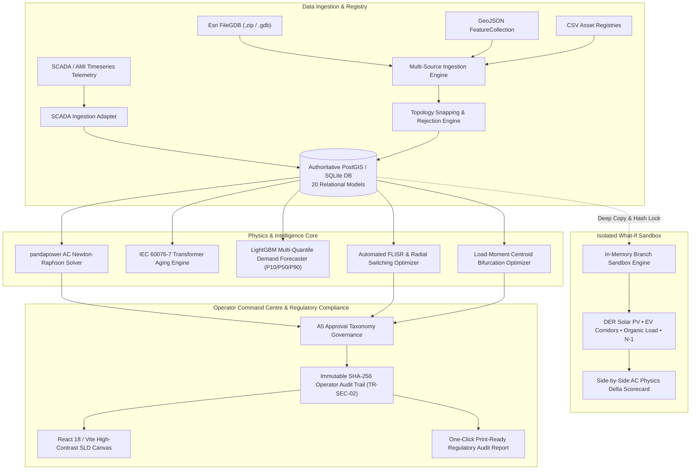

# GridSense-AI

### *Advisory-Only Cyber-Physical Digital Twin Platform for Electric Power Distribution Utilities*

[](https://www.python.org/)
[](https://fastapi.tiangolo.com/)
[](https://www.pandapower.org/)
[](https://react.dev/)
[](https://playwright.dev/)
[](https://pytest.org/)
[](#safety-governance--statutory-compliance)

---

## Executive Overview

**GridSense-AI** is a distribution grid management and digital twin platform built for State Electricity Distribution Companies (**DISCOMs**) and regulatory authorities. It bridges the gap between static Geographic Information Systems (GIS) and active grid physics by reconstructing brownfield distribution networks into authoritative, topologically verified, and electrically balanced digital twins.

Powered by a balanced **AC Newton-Raphson non-linear power flow engine** (`pandapower`), **IEC 60076-7 thermal differential aging models**, **LightGBM multi-quantile demand forecasting**, and **graph min-cut heuristic optimizers**, GridSense-AI provides control room operators with real-time situational awareness, automated FLISR restoration plans, and optimal CAPEX prioritization without requiring invasive hardware overhauls.

> [!IMPORTANT]
> **SAFETY & REGULATORY GOVERNANCE (A6 SAFETY SEPARATION):**  
> GridSense-AI is strictly an **ADVISORY-ONLY PLATFORM**. The software enforces zero autonomous SCADA writes. All switching plans, FLISR reconfigurations, and capital investment recommendations require human engineering review, field crew authorization, and cryptographic operator sign-off before dispatch staging.

---

## System Architecture



---

## Core Engineering Capabilities

### 1. Dual-Pipeline Network GIS & SCADA Telemetry Ingestion Hub
- **Enterprise GIS Ingestion**: Ingests zipped ESRI File Geodatabase archives (`.gdb.zip`), GeoJSON `FeatureCollection` datasets, and tabular CSV asset registries with automatic topology validation and row rejection reports.
- **SCADA Timeseries Ingestion**: Substation 15-minute and hourly active/reactive power ($P_{\text{MW}}, Q_{\text{Mvar}}$) and bus voltage ($V_{\text{pu}}$) telemetry records.
- **AMI/AMR Smart Meter & Environmental Logging**: Individual distribution transformer kW loadings, secondary phase currents, ambient temperature profiles, and solar radiation observations feeding thermal aging and predictive forecasting models.
- **Zero-Dependency One-Click Seed**: One-click initialization with bundled demo feeder network and 24-hour SCADA timeseries (`POST /api/v1/ingest/seed-demo`).

### 2. Network Digital Twin & Micro-Topology Magnifier
- High-contrast electrical Single Line Diagram (SLD) map canvas with color-coded voltage symbology ($<0.94\text{ pu}$ red, $0.94-1.06\text{ pu}$ green, $>1.06\text{ pu}$ yellow).
- Sub-second slide-in Asset Inspection Drawer dynamically linked to a **22x micro-topology cluster zoom magnifier** for high-density pole/DTR assemblies.
- Universal asset code search with auto-suggest and instant map fly-to navigation.

### 2. Balanced AC Newton-Raphson Power Flow Core
- Solves exact non-linear AC Kirchhoff power equations:
  $$P_i - jQ_i = V_i^* \sum_{k=1}^N Y_{ik} V_k$$
- Strict statutory voltage classification enforcing State Electricity Regulatory Commission (SERC) limits ($\pm 6.0\%$ nominal 11 kV band: $0.940 - 1.060\text{ p.u.}$).
- IEEE 738 dynamic conductor thermal ampacity corrected for ambient temperature and solar heating.
- Non-convergence detection returning structured HTTP 422 diagnostic payloads.

### 3. Diurnal Load Estimation & Financial Loss Accounting
- 24-hour diurnal curve allocation across 5 consumer archetypes: Domestic, Commercial, Industrial, Agricultural (7-hour shift), and Streetlight.
- Technical losses evaluated across conductor $I^2 R$ Ohmic dissipation and transformer no-load core + copper losses.
- Commercial monetization using Average Cost of Supply (ACoS ₹5.50/kWh) with Loss Load Factor ($LLF = 0.2 \cdot LF + 0.8 \cdot LF^2$).

### 4. IEC 60076-7 Dynamic Transformer Thermal Stress
- Real-time simulation of mineral-oil-immersed distribution transformer hottest-spot temperature ($\theta_h$) and top-oil rise ($\Delta \theta_o$).
- Arrhenius relative insulation aging acceleration rate ($V$):
  $$V = \exp\left( \frac{15000}{383} - \frac{15000}{\theta_h + 273} \right)$$
- Identifies critical transformer degradation (e.g. Beach 2 operating at $108.5\%$ loading with $3.82\times$ accelerated life consumption).

### 5. LightGBM Multi-Quantile Predictive Forecasting
- 1–24 hour ahead active power forecasting providing confidence intervals:
  - $P_{10}$: Lower bound (solar backfeed and minimum net demand risk).
  - $P_{50}$: Median expected operational baseline.
  - $P_{90}$: Upper bound peak contingency planning.
- Automated early-warning alert engine detecting impending thermal overloads.

### 6. Automated FLISR & Distribution Switching Workbench
- Multi-objective switching penalty function optimization:
  $$\min_{\mathbf{s}} J(\mathbf{s}) = w_1 \frac{P_{\text{loss}}(\mathbf{s})}{P_{\text{loss},0}} + w_2 \sum_{i \in \mathcal{B}} \max(0, 0.94 - V_i(\mathbf{s}))^2 + w_3 N_{\text{sw}} + w_4 \frac{L_{\text{unserved}}(\mathbf{s})}{L_{\text{total}}}$$
- Strict radiality preservation ($\det(A) \neq 0$, 0 loops, 0 unsupplied islands).
- Generates break-before-make ordered switching sequences for field dispatch crews.

### 7. CAPEX Intelligence & Asset Investment Planner
- Spatial graph min-cut feeder bifurcation based on minimum Euclidean distance to the load-moment centroid:
  $$\vec{C}_{LM} = \frac{\sum_{i=1}^N P_i \cdot L_i \cdot \vec{x}_i}{\sum_{i=1}^N P_i \cdot L_i}$$
- Conductor reconductoring feasibility (e.g. upgrading trunk Raccoon 75mm² to Dog 100mm²).
- Distribution transformer capacity augmentation (e.g. 250 kVA to 500 kVA Star-Delta).
- Discounted cash flow financial appraisal surfacing Capital Cost, Annual Loss Savings (₹), Payback Duration (years), Net Present Value (NPV), and Internal Rate of Return (IRR).

### 8. What-If Scenario Simulator ("Branch-and-Mutate" Sandbox)
- Completely isolated in-memory sandbox (`copy.deepcopy`) guaranteeing master database immutability.
- Pre- and post-simulation SHA-256 parent hash verification.
- Multi-variable mutation engine:
  - **DER Rooftop Solar PV Penetration** (kW capacity, power factor).
  - **EV Fast-Charging Corridors** (coincident peak charging demand).
  - **Multi-Year Organic Load Growth** (percentage scaling).
  - **N-1 Line Outage Contingencies**.
- Side-by-side comparative delta scorecard ($\Delta P_{\text{loss}}$, $\Delta V_{\min}$, $\Delta S_{\max}$, overloaded elements).

### 9. Executive Command Centre & Mathematical Audit Modals (`TR-UI-04`)
- Real-time multi-feeder operational fleet matrix comparing real brownfield feeders (e.g., KSEB Feeder `2011951`) with adjacent circuits.
- Transparent "View Calculation & Standards Audit" modal on every KPI card detailing:
  - Governing regulatory standards (CEA Regulations 2010, IEC 60076-7, SERC Distribution Code).
  - Mathematical LaTeX formula rendering via KaTeX.
  - Active input variables evaluated for the selected feeder.
  - Step-by-step arithmetic derivation progression.
  - pandapower AC solver convergence proof (iterations, tolerance, power balance error).

### 10. Immutable Operator Audit Trail (`TR-SEC-02`) & Report Export
- Tamper-evident ledger recording every switching approval, scenario run, and engineering sign-off with SHA-256 cryptographic hashes.
- Single-click **"Export Regulatory Engineering Audit Report"**:
  - Generates a high-resolution, print-ready HTML/PDF document with official utility headers, statutory notices, asset registries, thermal assessments, and engineering sign-off blocks.
  - Also available as structured JSON (`format=json`).

### 11. Multi-Format Ingestion Engine & SCADA Telemetry Hub
- **Resilient Multi-Format Network Ingestion**:
  - Direct on-the-fly extraction and topology validation of zipped ESRI File Geodatabase archives (`.gdb.zip`).
  - Full GeoJSON FeatureCollection adapter with topological snapping, bus/line connectivity inferencing, and coordinate transformation.
  - Tabular CSV asset registry ingestion with explicit row rejection logs and error codes.
- **Operational SCADA & AMI Smart Meter Telemetry Ingestion**:
  - Ingestion adapter for 15-minute / hourly substation active ($P\text{ MW}$) and reactive ($Q\text{ Mvar}$) power, bus voltage ($V\text{ p.u.}$), and DTR smart meter loadings ($P\text{ kW}$, current $I\text{ A}$, voltage $V$).
  - Dynamic ambient temperature ($T\text{ }^\circ\text{C}$) and solar irradiance ($W/\text{m}^2$) environmental observation logs.
  - Physics-based bounding validations and provenance tagging (`measured`).
  - Cryptographic SHA-256 audit ledger entry recording each operational ingestion batch.
- **One-Click Pre-Packaged Demo Twin**:
  - Immediate digital twin setup (`POST /api/v1/ingest/seed-demo`) provisioning the KSEB 11 kV Feeder network and 24-hour diurnal SCADA measurements without requiring proprietary local GIS geodatabases.


---

## Repository Structure

```
grid-sense/
├── backend/
│   ├── src/
│   │   ├── api/v1/             # FastAPI REST endpoints
│   │   │   ├── capex.py        # CAPEX optimization endpoints
│   │   │   ├── compliance.py   # Command centre, audit trail & report export
│   │   │   ├── flisr.py        # Automated FLISR restoration
│   │   │   ├── network.py      # Digital twin GeoJSON & SLD topology
│   │   │   ├── physics.py      # AC Newton-Raphson power flow
│   │   │   ├── scenarios.py    # What-If scenario sandbox endpoints
│   │   │   └── switching.py    # Sectionalizing & tie-switch reconfiguration
│   │   ├── models/             # SQLAlchemy ORM models (20 relational tables)
│   │   └── modules/            # Domain engineering & simulation engines
│   │       ├── capex/          # Bifurcation, reconductoring & DTR augmentation
│   │       ├── estimation/     # Diurnal load allocation & ACoS valuation
│   │       ├── forecast/       # LightGBM multi-quantile demand forecaster
│   │       ├── ingest/         # FileGDB & GeoJSON parser adapters
│   │       ├── physics/        # pandapower AC network builder & solver
│   │       ├── scenarios/      # In-memory branch-and-mutate sandbox engine
│   │       ├── switching/      # Graph radiality & multi-objective FLISR
│   │       └── thermal/        # IEC 60076-7 dynamic thermal model
│   └── migrations/             # Alembic database migration scripts
├── frontend/
│   ├── src/
│   │   ├── components/         # Reusable UI widgets & inspection modals
│   │   │   ├── CalculationAuditModal.tsx # TR-UI-04 mathematical audit modal
│   │   │   ├── ClickableAsset.tsx        # Dynamic cross-tab map deep-linker
│   │   │   ├── DTRClusterZoomWindow.tsx  # 22x micro-topology cluster zoom
│   │   │   └── AssetInspectionDrawer.tsx # Slide-in asset inspection panel
│   │   ├── views/              # Major application workspaces
│   │   │   ├── CapexPlanner.tsx          # CAPEX Intelligence Planner
│   │   │   ├── ExecutiveOverview.tsx     # Multi-Feeder Command Centre
│   │   │   ├── NetworkMap.tsx            # Digital Twin Leaflet/MapLibre map
│   │   │   ├── ScenarioSimulator.tsx     # What-If Scenario Sandbox
│   │   │   └── SwitchingWorkbench.tsx    # Switching & FLISR Workbench
│   │   └── App.tsx             # Application shell & tab router
│   ├── package.json
│   └── vite.config.ts
├── docs/                       # Living engineering documentation
│   ├── ASSUMPTIONS.md
│   ├── LIMITATIONS.md
│   ├── RISKS.md
│   └── TRACEABILITY.md
├── e2e/                        # Playwright End-to-End integration test suite
│   ├── 01_shell_navigation.spec.ts
│   ├── 02_digital_twin_drawer.spec.ts
│   ├── 03_capex_intelligence.spec.ts
│   ├── 04_switching_workbench.spec.ts
│   ├── 05_asset_search_and_deeplink.spec.ts
│   ├── 06_scenario_simulator.spec.ts
│   └── 07_command_centre_and_compliance.spec.ts
├── tests/unit/                 # Pytest backend unit test suite (90 tests)
├── MODEL_CARD.md               # Standard cyber-physical power AI model card
├── playwright.config.ts        # Playwright test configuration
└── pytest.ini
```

---

## Getting Started

### Prerequisites
- **Python:** 3.12 or higher
- **Node.js:** 18.0 or higher
- **Package Manager:** npm or pnpm

### 1. Backend Setup
```bash
# Clone the repository
git clone https://github.com/adityapande403/GridSense-AI.git
cd GridSense-AI

# Create and activate virtual environment
python -m venv .venv
source .venv/bin/activate  # On Windows: .venv\Scripts\activate

# Install backend dependencies
pip install -r backend/requirements.txt
```

### 2. Frontend Setup
```bash
# Install frontend dependencies
cd frontend
npm install
cd ..
```

### 3. Running the Development Servers
In separate terminal sessions:

```bash
# Start FastAPI backend (port 8000)
uvicorn backend.src.main:app --host 127.0.0.1 --port 8000 --reload

# Start Vite React frontend (port 5174)
npm --prefix frontend run dev -- --host 127.0.0.1 --port 5174
```

Access the web interface at **`http://127.0.0.1:5174`** and the interactive Swagger API documentation at **`http://127.0.0.1:8000/docs`**.

---

## Automated Verification & Testing

GridSense-AI includes comprehensive unit and end-to-end integration test suites:

### Backend Unit Tests (90 Tests)
```bash
# Execute full backend test suite
pytest tests/unit/ -v
```

### Playwright End-to-End Test Suite (13 Tests)
```bash
# Run all end-to-end browser integration tests
npx playwright test --project=chromium
```

### Production Build Verification
```bash
# Verify TypeScript compilation and Vite production build
npm --prefix frontend run build
```

---

## Reference Dataset: KSEB Puthiya Kadavu Feeder

GridSense-AI is natively calibrated against the real-world **Puthiya Kadavu 11 kV Feeder (`2011951`)**, Kozhikode Electrical Circle, Kerala State Electricity Board (KSEB):
- **Primary Substation:** 33/11 kV Puthiya Kadavu Substation (2x5 MVA PTRs)
- **Feeder Trunk:** Raccoon 75mm² ACSR ($R = 0.434\,\Omega/\text{km}$, ampacity $260\text{ A}$)
- **Assets:** 574 line sections (14.8 km route length), 24 Distribution Transformers (2.15 MVA total capacity), 632 electrical buses, and 8 sectionalizing/tie switches.
- **Critical Baseline Hotspot:** DT-2011951-001 (Beach 2) operating under thermal overload ($108.5\%$ loading, hotspot $\theta_h = 113.6^\circ\text{C}$).

---

## Safety Governance & Statutory Compliance

GridSense-AI enforces two core architectural principles to prevent unverified actions:

1. **A5 Approval Taxonomy:**  
   Every recommendation is evaluated through automated multi-stage electrical gating and labeled as `VALIDATED_FEASIBLE`, `FEASIBLE_WITH_WARNINGS`, `FEASIBLE_PROTECTION_UNVERIFIED`, or `NOT_FEASIBLE`.
2. **A6 Safety Separation:**  
   Automated control actions without human operator sign-off are strictly blocked by design. Recommended plans remain in a staged state until an authorized engineer registers a cryptographic sign-off in the audit ledger.

---

## License & Attribution

Developed for power distribution utilities, research laboratories, and regulatory bodies. For detailed architectural and mathematical specifications, refer to [MODEL_CARD.md](file:///d:/Aditya/grid-sense/MODEL_CARD.md) and [TRACEABILITY.md](file:///d:/Aditya/grid-sense/docs/TRACEABILITY.md).
